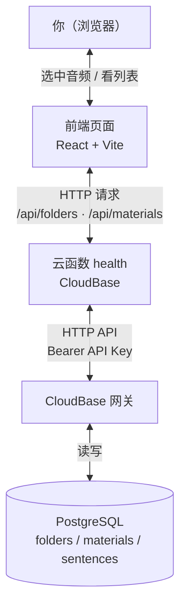

# XingHo Read　技术设计文档（TECH_DESIGN）

| 项目信息 | 内容 |
|---|---|
| 产品名称 | XingHo Read |
| 所属项目 | vibe coding（第 1 周 Day 5 初稿；第 3 周 Day 19 重写） |
| 文档日期 | 2026-09-20（初稿）/ 2026-10-11（重写）/ 2026-10-14（Day 27 补音频方案） |
| 上游依据 | `PRD.md`（第 3 版）、`方向变更说明.md`、`api-contract.md` |
| 文档状态 | **第 2 版 —— 第一至六节骨干推翻重写**；第六节「音频存储方案」已于 Day 27 定案并实测 |

> **为什么要重写**：初稿（Day 5）写的是「纯前端 + 数据只在本机」。
> 第 3 周课程要求接入真实数据库，技术路线实际改成了
> 「前端 + 云函数 + 云数据库」，**初稿整篇反过来**。
> 旧版留档在 git 历史里（改动前的提交都能查到）。
>
> **接口细节不看这份文档** —— 路径、字段、状态码以 `api-contract.md` 为准；
> 后端代码怎么分层看 `架构说明.md`。

---

## 一、一句话说清数据流向

> **数据从「你新建一条材料」开始，经过云函数，存进云端数据库，再读回页面 —— 所以你换一台电脑、清一次缓存，材料都还在。**

和初稿的区别：初稿是「到存进你自己浏览器的本地存储结束，全程不经过任何服务器」。
现在**每一份数据都要经过服务器**。

---

## 二、数据从哪来、到哪去

### 数据来源（四个入口）

| # | 数据 | 从哪来 | 现状（Day 27） |
|---|---|---|---|
| ① | **音频文件** | 命令行传到静态托管 `audio/` 目录，再粘贴地址 | ✅ **方案已定并实测**（见第六节「音频存储方案」） |
| ② | **英文文本**（可选） | 你粘贴进来 | ✅ 表已建（`materials` / `sentences`） |
| ③ | **你的录音** | 你的麦克风 | ✅ **能录能回听**（F3 已在练习页实现；不上传，只在浏览器里） |
| ④ | **打卡记录** | 完成跟读录音时产生 | ⏳ 未实现（F4 还没做） |

### 数据流向表

| 数据 | 从哪来 | 存在哪 | 到哪去 |
|---|---|---|---|
| 文件夹 | 你新建 | **云端** `folders` 表 | 首页文件夹列表 |
| 材料（标题 + 所属文件夹） | 你新建 | **云端** `materials` 表 | 首页材料列表 |
| 音频文件 | 命令行传到静态托管 | **静态托管桶** `audio/` 目录（库里只存 URL） | 练习页播放 |
| 英文文本 | 你粘贴 | **云端** `materials` / `sentences` 表 | 练习页句子列表 |
| 句段的时间位置 | 按「总时长 ÷ 行数」平均分（近似） | **云端** `sentences` 表的 `start_ms` / `end_ms` | 逐句播放、单句循环 |
| 你的录音 | 麦克风 | **只在浏览器内存里**（blob，不上传） | 回听 |
| 打卡记录 | 完成跟读录音时产生 | ⏳ 未定（未实现） | 首页的「连续打卡 N 天」「本月天数」 |

**一句话概括**：数据**来源是用户**（命令行传文件、粘贴、麦克风），**存放基本全在云端 PostgreSQL**
（音频文件例外，在静态托管），**去向是同一个页面**。⚠️ 表里带「⏳」的那一项还没落地。

> **⭐ 「句段」不是切好的小音频文件** —— 只存时间戳。播放第 N 句 =
> `audio.currentTime = startMs / 1000`，播到 `endMs` 停。**所以一条材料只需要 1 个音频文件。**

### 已经建好的三张表

| 表 | 存什么 | 关联 |
|---|---|---|
| `folders` | 文件夹（id / name / created_at） | — |
| `materials` | 材料（id / title / folder_id / audio_url / created_at） | `folder_id` → `folders.id` |
| `sentences` | 句段（material_id / no / text / start_ms / end_ms） | `material_id` → `materials.id` |

> 建表脚本：`db/schema.sql`；种子数据：`db/seed.sql`。
> ⚠️ 注意 `materials.audio_url` 这一列**已经在表里了，但怎么往里写还没定**。

---

## 三、数据流图

### 图（Mermaid，GitHub 网页上会自动渲染成图）



### 同一张图的纯文本版（记事本里也能看）

```
【数据从哪来】
  你（浏览器）──选中音频 / 粘贴文本──▶ 前端页面

【数据怎么走】
  前端页面 ──HTTP 请求 /api/…────────▶ 云函数 health
  云函数   ──HTTP API + API Key──────▶ CloudBase 网关
  网关     ──读写─────────────────────▶ PostgreSQL（三张表）

【数据到哪去】
  PostgreSQL ──原路返回 JSON──▶ 前端页面 ──渲染──▶ 你看到列表
```

### 从图里能读出的三件事

1. **有服务器了** —— 图上多出「云函数」和「网关」两个环节，跑在腾讯云的机器上。
2. **存储点在云端** —— 不再是浏览器 IndexedDB，而是云端的 PostgreSQL。
3. **前端不直连数据库** —— 所有读写都要经过云函数。这样做的好处是：
   数据库凭证只存在云函数的环境变量里，**浏览器里拿不到**。

---

## 四、技术路线

| 用途 | 用什么 | 为什么选它 |
|---|---|---|
| 界面框架 | **React + Vite** | 三个页面（首页 / 练习页 / 新建页）各写成一个组件，职责清楚。Vite 负责跑起来和打包 |
| 界面样式 | **手写 CSS** | 只依赖 CSS 本身，不引入额外规则；出问题容易定位 |
| 编程语言 | **JavaScript（不用 TypeScript）** | 瓶颈是「功能做对」，不是类型安全；少一层语法负担 |
| 路由 | **手写哈希路由**（`src/useHashRoute.js`） | 三个页面不值得引入路由库；哈希路由可直达、可刷新、后退键生效 |
| 后端 | **腾讯云 CloudBase 云函数**（Web 函数） | 课程指定的云平台；**免费体验版**，不用自己买服务器 |
| 数据库 | **CloudBase PostgreSQL**（`public` schema） | 环境创建时就定了 PG 模式；三张表已建好 |
| 云函数访问数据库 | **CloudBase HTTP API（PostgREST）** | ⚠️ 共享集群**不给数据库外网地址**，云函数直连不可行，只能走 HTTP API |
| 后端代码分层 | **四层**：`index.js` / `repo.js` / `db.js` / `http-utils.js` | 详见 `架构说明.md` |
| 把音频按停顿切成句段 | **Web Audio API**（计划） | 浏览器自带能力：读波形 → 在静音处切开。不装第三方库、不花钱 |
| 逐句播放 / 单句循环 | **HTML 音频播放 + React 状态控制**（计划） | 播放是浏览器原生能力；循环逻辑由前端状态控制 |
| 跟读录音 / 回听 | **MediaRecorder API**（计划） | 浏览器自带录音能力，不装插件 |
| 音频文件存哪 | **静态托管的 `audio/` 目录**（命令行上传） | ✅ Day 27 定案并实测（上传成功 + CDN 200）。本环境**没有云存储桶**，托管桶也不挂存储 API，所以用这个。见第六节 |
| 版本管理 | **Git + GitHub** | 已连续使用，流程熟练 |
| 运行方式 | 前端已上静态托管公网；接口已部署公网 | 两边都在线上（Day 20 起）。CORS 由腾讯云网关自动提供，不用配 |

---

## 五、这一版不引入的东西（以及为什么）

| 不引入 | 为什么 |
|---|---|
| **账号 / 登录系统** | 排在后续版本。**注意：不是因为「没有后端」—— 后端和数据库现在都有** |
| **行级权限（RLS）** | 本期没有账号，数据是练习材料，风险可接受。⚠️ **有账号体系后必须补上** |
| TypeScript | 不需要，减少学习与排查成本 |
| 现成 UI 组件库 | 页面简单，引入反而被它的规矩绑住，体积也大 |
| 路由库 | 三个页面，手写哈希路由够用 |
| 视频素材 | PRD 明确列为本期不做；视频里的音频不能被浏览器直接解码做断句 |
| 服务端框架（Express / Koa 等） | 云函数用 Node 内置 `http` 模块就够；少一层依赖，冷启动更快 |
| ORM | 走 HTTP API，没有 SQL 可写，ORM 无用武之地 |

> **和初稿最大的差别**：初稿的第一、二条是「不引入后端服务器」「不引入服务器端数据库」——
> 这两条**已经作废**，现在两者都在用。

---

## 六、已知的技术风险（写清代价，不藏）

| 风险 | 说明 | 应对 |
|---|---|---|
| ~~**音频存储方案未定**~~ | ~~音频是几 MB 的二进制文件，不能塞进数据库或 JSON 请求体。存哪、怎么上传、句段切完存哪，都还没定~~ | **✅ 已定（Day 27，实测过）** —— 见下方「音频存储方案」小节 |
| **表写权限要一张一张开** | `anon` 角色默认只能读。每新增一张**要写**的表，都要单独 `GRANT INSERT/UPDATE/DELETE`，而且**只能在控制台点**（执行 SQL 的 HTTP API 只有管理员能调） | 已登记成待办。⚠️ 漏授权时接口回的是 `CONFIG_ERROR`（Day 27 专门加的），不是含糊的「服务出问题了」—— 否则用户会一直重试 |
| **共享集群不给外网地址** | 云函数直连数据库不可行（控制台原话「可升级至独享集群后启用」），只能走 HTTP API | 已绕开（走 HTTP API）。代价是**不能写 SQL**，JOIN / GROUP BY 都用不了 |
| **PostgREST 不支持 JOIN** | 「文件夹有几个材料」「材料有几段」只能「取全表 + 内存计数」 | 数据量小时无所谓；材料涨到几百条要改成在库里建**视图** |
| **三张表都没有 RLS** | 没有行级权限，拿到 API Key 的人能读全部数据 | 本期无账号、数据是练习材料，可接受；**有账号后必须补 RLS** |
| **控制台手填长值会静默丢失** | 1178 字符的 API Key 在控制台填进去后，函数运行时读不到（试了 3 次） | 改用 **CLI 推配置**（`--config-file cloudbaserc.local.json`）。详见 `db.js` 头部注释 |
| **部署会把环境变量抹掉** | `tcb fn deploy` 默认读主配置（里面没有 Key），会覆盖云端配置 | 凡是碰这个函数的命令**一律带 `--config-file`** |
| **免费体验版 2027-03-28 到期** | 到期后服务可能停 | 到期前决定续费还是迁移（已写进 PRD 第六节成功标准） |
| ~~**前端还没接真接口**~~ | ~~接口全通了，但页面读的仍是 `src/mock/homeData.js`~~ | **✅ 已全部解决（Day 27）**：首页、练习页、新建页**都**改读真接口，`src/` 里已无代码引用 mock |
| ~~**CORS 还没配**~~ | ~~前端一旦调接口就会撞跨域~~ | **✅ 已解决（Day 19 追加②）—— 结论是「不用配」**：腾讯云网关自动提供完整 CORS，函数里加反而会拼成非法值。⚠️ 但 `OPTIONS` 必须接住回 `204`，且**这个坑 curl 测不出来**（curl 不发预检） |
| **断句可能不准** | 自动切句依赖素材质量：要读得清晰、句间有可辨识的停顿 | PRD 里已写明这是**前提条件**。⚠️ Day 27 起新建页用的是**「总时长 ÷ 行数」平均分**，比自动切句更粗 —— 界面上已如实写明「是近似值」 |
| **浏览器兼容** | 录音（MediaRecorder）在现代浏览器都支持，老旧浏览器可能不行 | 本期约定使用 Chrome / Edge 最新版 |

### 音频存储方案（Day 27 定案，已实测）

**结论：音频文件放静态托管的 `audio/` 目录，`materials.audio_url` 存它的完整地址。**

**为什么是这个方案**（4 个候选都实测过）：

| 方案 | 实测结果 | 结论 |
|---|---|---|
| 云存储（`tcb storage`） | `tcb storage buckets list` → **`No buckets`**，本环境一个桶都没有 | ❌ 不可用 |
| 用静态托管桶走存储 API | 报 `STORAGE_BUCKET_NOT_FOUND`（托管桶不挂存储 API） | ❌ 不可用 |
| **命令行传到静态托管** `tcb hosting deploy "音频.mp3" audio/x.mp3` | ✅ **上传成功，CDN 返回 200** | ✅ **主方案（B）** |
| 粘贴任意外链 | 只要地址可访问就行 | ✅ **兜底（C）** |

**⭐ 关键简化：全项目只需要 1 个音频文件/条材料。**
`sentences` 表存的是 `start_ms` / `end_ms`（**在音频里的位置**），不是切好的小文件。
播放第 N 句 = `audio.currentTime = startMs / 1000`，播到 `endMs` 停。
所以**不需要「一条材料 N 个音频」**，也不需要音频处理服务。

**⚠️ 补充：没有句段时也能「整段播放」（Day 27 追加）**
句段是**后来才补**的（老师整理文本、或自动断句）。在那之前材料**只有音频**，
而原实现把播放按钮写成了 `disabled={!hasAudio || !hasSentences}` ——
**音频明明加载好了却一个按钮都点不动**（48 条星一班就是这种情况）。
现在改成：**「有没有音频」决定能不能播，「有没有句段」只决定能不能逐句**。
- 有句段 → 逐句播放 / 单句循环（PRD F2，不变）
- 没句段 → **整段播放**（播放 / 暂停随时可用，状态栏显示 `整段播放 0:12 / 0:40`）
- 这是**超出 PRD 的补丁**，但符合 PRD 的前提假设：F2 的「逐句」建立在「已断句」之上，
  而断句是**可选的后续步骤**，不该成为「能不能听」的门槛。

**上传流程**（命令行，一次性）：

```bash
tcb hosting deploy "音频.mp3" audio/材料名.mp3
# 得到 https://xingho-read-d0gamjt5d859dbd81-1497420413.tcloudbaseapp.com/audio/材料名.mp3
```

拿到地址后，粘到新建页的「③ 音频地址」框里。

**⚠️ 代价要说清楚**：
1. **上传是手动的**（命令行）。界面上**没有**「选择本地文件」入口 —— 留着它就是个点了没用的按钮
   （Day 14 记录的「沉默的失败」）。所以新建页改成明确的「粘贴音频地址」+ 写清怎么拿到地址。
2. 静态托管**没有版本管理**（`tcb hosting deploy` 是纯文件上传），传错了要手动覆盖或删。
3. 句子时间目前是**平均分**的近似值，不是按真实停顿切的。真按静音切要用 Web Audio API 读波形，
   属后续功能。**界面上如实写着「是近似值」**，不假装是精确切分。

---

## 七、这份文档的下游

- **写代码**：照着第四节的技术路线，照着第三节的图安排各模块之间的数据传递。
- **加新接口**：先看 `架构说明.md` 第六节（加接口该动哪几个文件），再看 `api-contract.md`（契约格式）。
- **验收时**：用 `PRD.md` 的验收标准逐条对照。
  ⚠️ 其中 F1 里「断开网络后仍可见」这一条**已不成立**（数据在云端，断网就打不开），验收时要改口径。
- **方案变化时**：本文档一旦修改，受影响的文件与功能需重新核对。
